<div align="center">

# 🌟 Mingo — Language Learning

**Bite-sized, structured language lessons with gold-standard spaced repetition.**

[](https://nextjs.org/)
[](https://www.typescriptlang.org/)
[](https://bun.com/)
[](https://tailwindcss.com/)
[](https://biomejs.dev/)
[](./src/)

[Features](#-core-features) • [State Machine](#-state-machine--lifecycle) • [Gallery](#-feature-gallery) • [Architecture](#-architecture--boundaries) • [Verification](#-verification--testing) • [Quickstart](#-quickstart)

<br/>


_Watch the high-definition walkthrough: [`docs/assets/demo.mp4`](docs/assets/demo.mp4)_

</div>

---

## 📖 Overview

**Mingo** is a fast, responsive web application designed for structured language learning. Built with Next.js App Router, TypeScript, and Bun, Mingo pairs a warm gold visual identity with cognitive science learning principles: **guided progression**, **immediate feedback**, and **spaced repetition memory retrieval**.

Mingo is completely self-contained with project-owned assets, custom typography, zero proprietary marks, zero external cloud runtime requirements, and native database persistence.

---

## ✨ Core Features

### 1. 🎨 Gold-Themed Visual Identity & Responsive Shell

- **Original Color System:** Warm cream background surfaces (`#FAF6EE`), deep ink text (`#1C1917`), and amber/gold accents (`#D97706`).
- **Responsive Layout:** Adaptive desktop side-rail navigation that transforms into a compact header on mobile devices (tested at 390×844px and desktop resolutions).
- **Accessibility:** High-contrast focus rings (`focus-visible`) and native `prefers-reduced-motion` compliance.

### 2. 🔐 Learner Authentication & Profile Setup

- **Zero-Dependency Crypto:** Passwords are securely hashed with PBKDF2 (100,000 iterations of SHA-256 with 16-byte cryptographically secure salts) via standard Web Crypto API.
- **Session Security:** Authenticated via HTTP-only, secure, `SameSite=Lax` cookies.
- **Onboarding Flow:** Learners personalize their target curriculum (e.g. Spanish Essentials) and daily commitment (Casual 5m, Regular 10m, Serious 15m, Intense 20m).

### 3. 🗺️ Guided Learning Path & Progressive Unlocking

- **Curated Curriculum:** Versioned course schemas (`course.schema.ts`) with thematic units (e.g., _Greetings & Introductions_, _Everyday Communication_).
- **Deterministic Path Engine:** Calculates lesson availability in pure logic (`path.calc.ts`):
  - **Completed:** Lesson finished with score badge and review option.
  - **Current:** Unlocked, highlighted, and linked directly in the prominent **Resume Banner**.
  - **Locked:** Future units and lessons gated until prerequisites are completed.

### 4. ⚡ Interactive Multi-Exercise Lesson Session

- **Exercise Types:**
  - **Multiple Choice:** Instant option selection with keyboard shortcuts (1–4).
  - **Typed Recall:** Clean text input with normalized matching (accents, punctuation, and accepted variants).
  - **Listening Challenge:** Audio pronunciation powered by Web Speech Synthesis with fallback explanations.
- **Immediate Feedback Loop:** Color-coded bottom drawers with explanations:
  - **Correct:** Green drawer (`#DCFCE7`), checkmark badge, explanation, and XP increment.
  - **Incorrect:** Red drawer (`#FEE2E2`), correct answer reveal, and queueing for review.
- **Lesson Completion:** Accuracy percentages and XP calculated and saved upon completion.

### 5. 🧠 Spaced Repetition (SRS) Review Engine

- **Explainable Scheduler:** SM-2 / Leitner hybrid model (`review.calc.ts`):
  - **First Correct Attempt:** Interval = 1 day.
  - **Consecutive Correct:** Expands to 3 days, then multiplies by the ease factor (`interval * easeFactor`).
  - **Incorrect Recall:** Streak resets to 0, interval drops to 1 day, and ease factor recalibrates.
- **Learner Isolation:** Strict database constraints ensure learners only review their own vocabulary queue.
- **Review Session:** Surface due cards at `/review` with immediate interval extension.

### 6. 📊 Learner Analytics, Streaks & Daily Goals

- **Deterministic Day-Boundary Tracking:** Pure calculation (`streak.calc.ts`) walking backward through calendar days; preserves streak if yesterday was active even before today's lesson.
- **Daily Goal Progress:** Real-time completion meter comparing estimated practice minutes against the learner's chosen target.
- **Activity History:** Chronological log of completed lessons, earned XP, and accuracy ratings.

### 7. 🛡️ Privacy-Conscious Telemetry

- **Data Minimization:** Built-in event schema (`telemetry/events.ts`) captures milestones (`onboarding_completed`, `lesson_completed`, `review_completed`) without sending learner answers, passwords, or PII.
- Obfuscates learner IDs with deterministic non-reversible hashes.

### 8. 🛠️ Modern Mechanical Toolchain

- **Bun Runtime:** Fast package installation with frozen lockfile support.
- **Dual Typecheck Lanes:** Ultra-fast typechecking with `tsrs` (Rust TypeScript compiler) paired with `tsc --noEmit` as the reference standard.
- **Biome:** Unified fast formatter and linter.
- **Lefthook:** Deterministic pre-commit hook runner.
- **Agent-Browser:** Automated browser verification running both Lightpanda (fast DOM engine) and Chrome (visual rendering & error audits).

---

## 🔄 State Machine & Lifecycle

The Mingo learner lifecycle and interactive state machine is modeled below.

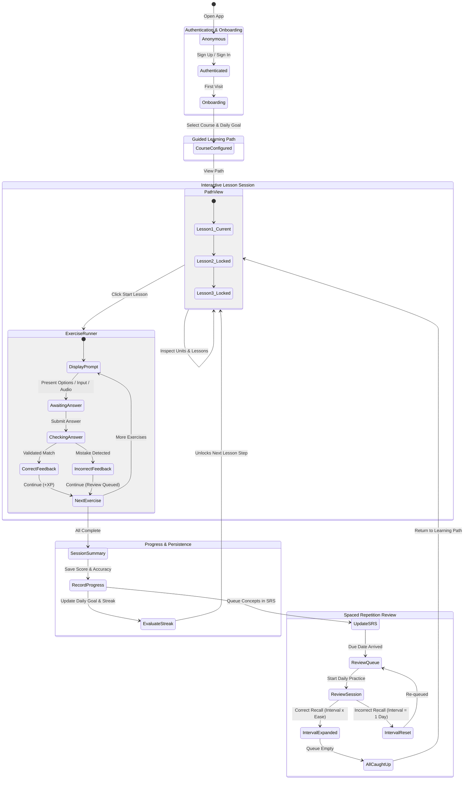

> **Diagram Note:** Rendered synchronously to SVG via [**Pele**](https://github.com/obsidianmd/pele) (`@obsidianmd/pele` v1.9.0):
> - **Vector Asset:** [`docs/assets/state-chart.svg`](docs/assets/state-chart.svg)
> - **Rendered Image:** [`docs/assets/state-chart.png`](docs/assets/state-chart.png)
> - **Generator Script:** `bun run scripts/generate-state-chart.ts`

<div align="center">
  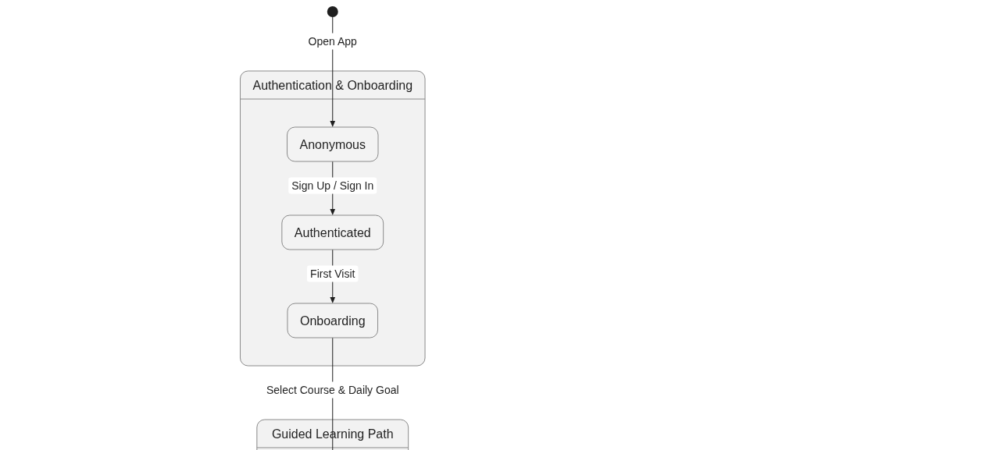
</div>

---

## 📸 Feature Gallery

<table align="center" width="100%">
  <tr>
    <td width="50%" align="center">
      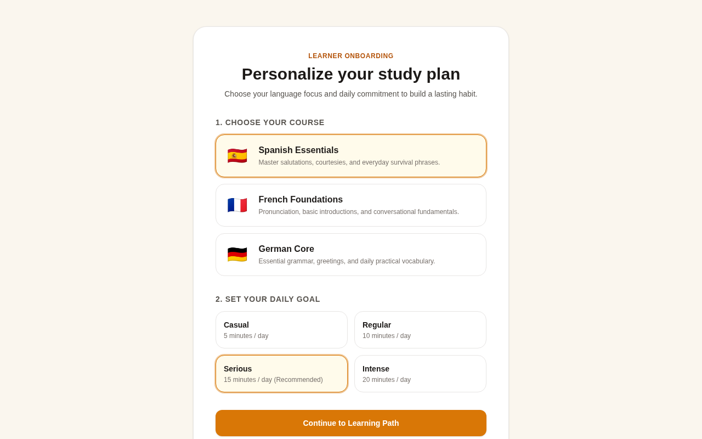<br/>
      <b>1. Personalized Onboarding</b><br/>
      <i>Select target language and daily goal commitment.</i>
    </td>
    <td width="50%" align="center">
      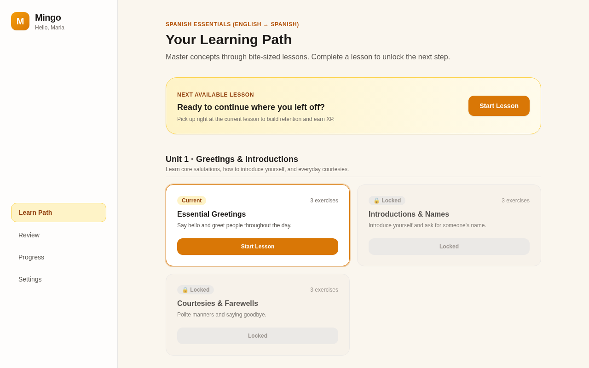<br/>
      <b>2. Guided Learning Path</b><br/>
      <i>Unit breakdown, resume card, and progressive unlocking.</i>
    </td>
  </tr>
  <tr>
    <td width="50%" align="center">
      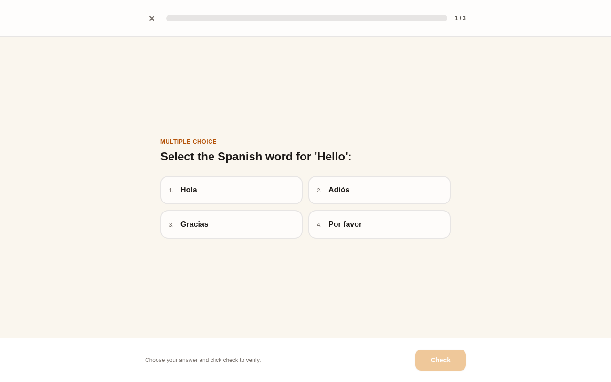<br/>
      <b>3. Interactive Exercise Session</b><br/>
      <i>Multiple choice, typed recall, and listening with audio.</i>
    </td>
    <td width="50%" align="center">
      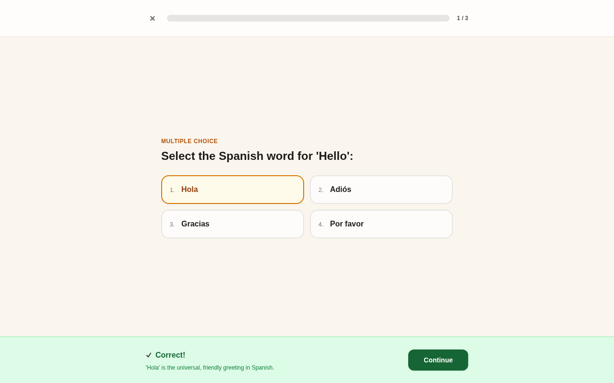<br/>
      <b>4. Immediate Feedback Drawer</b><br/>
      <i>Instant correctness verification and concise explanations.</i>
    </td>
  </tr>
  <tr>
    <td width="50%" align="center">
      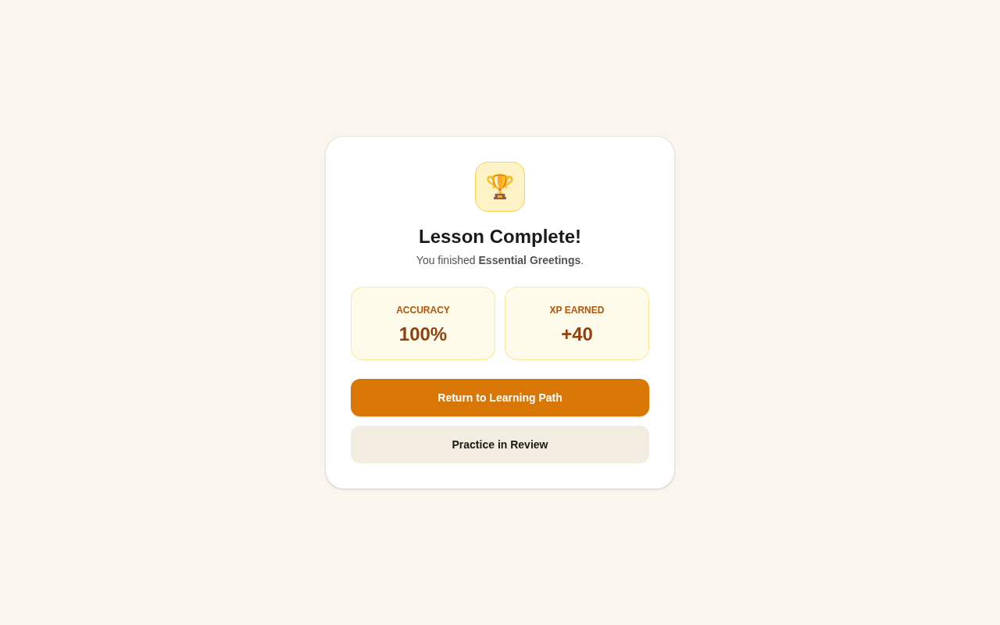<br/>
      <b>5. Lesson Completion Summary</b><br/>
      <i>Accuracy calculations, XP earned, and SRS queueing.</i>
    </td>
    <td width="50%" align="center">
      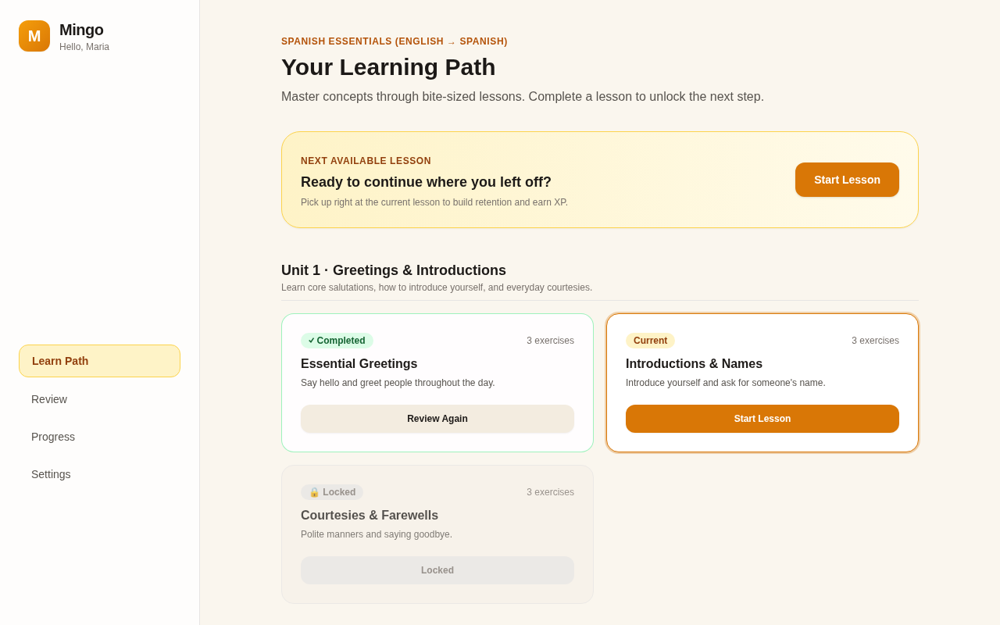<br/>
      <b>6. Dynamic Path Unlock</b><br/>
      <i>Lesson 1 completed; Lesson 2 automatically becomes current.</i>
    </td>
  </tr>
  <tr>
    <td width="50%" align="center">
      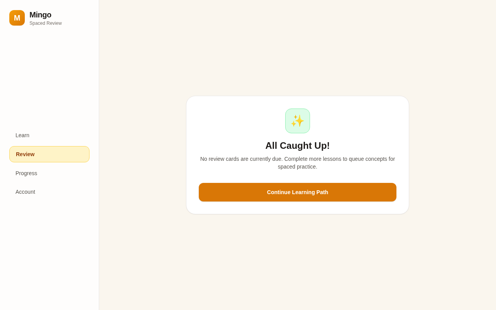<br/>
      <b>7. Spaced Repetition Practice</b><br/>
      <i>Practice due flashcard concepts with interval expansion.</i>
    </td>
    <td width="50%" align="center">
      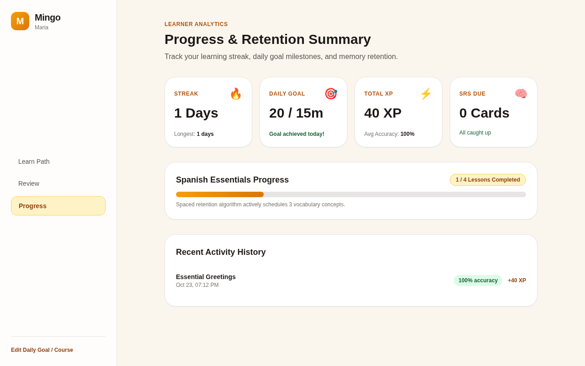<br/>
      <b>8. Progress & Retention Dashboard</b><br/>
      <i>Streak tracker, daily goal progress, and activity history.</i>
    </td>
  </tr>
  <tr>
    <td colspan="2" align="center">
      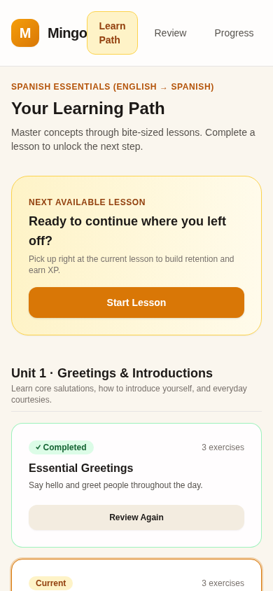<br/>
      <b>9. Mobile Responsive Layout</b><br/>
      <i>Seamless touch-friendly experience on phones and tablets.</i>
    </td>
  </tr>
</table>

---

## 🏗️ Architecture & Boundaries

```
mingo/
├── app/ -> src/app/          # Next.js App Router: transport & composition only
├── src/
│   ├── app/                  # Route layouts, pages, API handlers
│   │   ├── api/              # Endpoints (auth, lesson, onboarding, review, telemetry, health)
│   │   ├── lesson/[id]/      # Interactive exercise session runner
│   │   ├── login/            # Sign in / sign up form
│   │   ├── onboarding/       # Course and daily goal selector
│   │   ├── progress/         # Learner analytics dashboard
│   │   ├── review/           # Spaced repetition review queue
│   │   ├── error.tsx         # User-friendly error recovery UI
│   │   ├── not-found.tsx     # Custom 404 page
│   │   └── loading.tsx       # Loading skeleton UI
│   ├── features/             # Self-contained domain modules
│   │   ├── auth/             # PBKDF2 crypto, session store, auth service & repo
│   │   ├── course/           # Course schemas, runtime validator, starter content
│   │   ├── lesson/           # Progress persistence repository
│   │   └── review/           # SRS queue repository & attempt service
│   ├── server/
│   │   ├── auth.helper.ts    # Server cookie and learner extraction
│   │   └── db/               # Unified SQLite database client & schema.sql
│   └── shared/
│       ├── calc/             # Pure calculations (scoring, path, review, streak)
│       └── telemetry/        # Privacy-conscious event schemas & validators
├── docs/                     # Architecture, deployment, and assets
└── tasks/                    # Implementation plan and task tracking
```

### Boundary Rules

- **One-Way Dependency Flow:** UI/routes $\to$ Domain Services $\to$ Repositories $\to$ Database.
- **Pure Math Isolation:** Domain algorithms in `src/shared/calc/` have **zero** framework or database dependencies.
- **Server DB Protection:** Client components never import from `src/server/db/`.
- **No Dumping Grounds:** No barrel `index.ts` files and no generic `utils/` dumping folders.

---

## 🧪 Verification & Testing

Every layer of Mingo is checked with automated mechanical suites:

```bash
# Run Biome lint, reference typecheck, fast typecheck, unit tests, and production build
bun run verify
```

### 1. Logic Unit Tests (`bun test`)

33 unit tests across 9 test suites covering pure logic:
- `scoring.calc.test.ts`: Accent/punctuation normalization, variant matching, accuracy percentages.
- `path.calc.test.ts`: Lesson state computation, progressive unlocking, and resume detection.
- `review.calc.test.ts`: SM-2 interval expansion, error resets, and due date checks.
- `streak.calc.test.ts`: Day boundary handling, missed days, and daily goal meters.
- `auth.crypto.test.ts`: PBKDF2 hashing, salt uniqueness, and constant-time verification.
- `auth.service.test.ts`: Sign-up, duplicate email rejection, session expiry, and sign-out.
- `course.schema.test.ts`: Runtime course schema validation.
- `review.service.test.ts`: Learner review isolation and queue retrieval.
- `telemetry.events.test.ts`: Data minimization and forbidden key stripping.

### 2. Dual Typecheck Lanes

- **Fast Lane:** `bun run typecheck:fast` executes `tsrs` (Rust TypeScript compiler).
- **Reference Lane:** `bun run typecheck` executes official `tsc --noEmit`.

### 3. Browser Automation with `agent-browser`

- **Lightpanda Engine:** Fast DOM accessibility tree verification without pixel overhead.
- **Chrome Engine:** End-to-end visual verification, screenshot capture, and zero-console-error checks.

---

## 🚀 Quickstart

### Prerequisites

- [Bun](https://bun.com/) (version 1.2+ or 1.4+)
- Node.js (v20+ or v22+)

### Installation & Run

```bash
# 1. Clone repository
git clone https://github.com/your-username/mingo.git
cd mingo

# 2. Install dependencies with exact lockfile
bun install --frozen-lockfile

# 3. Start local development server
bun run dev

# 4. Open in browser
open http://localhost:3000
```

### Production Build & Deployment

```bash
# Build production bundle
bun run build

# Start production server
bun run start
```

For cloud hosting and Supabase Postgres deployment, see [`docs/DEPLOYMENT.md`](docs/DEPLOYMENT.md).

---

## 📄 License

This project is open-source software licensed under the [MIT License](LICENSE).
